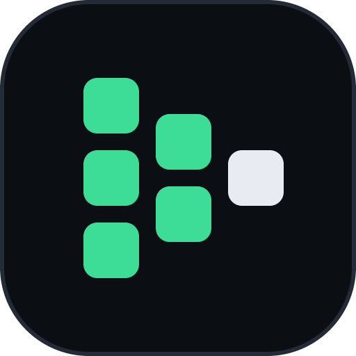
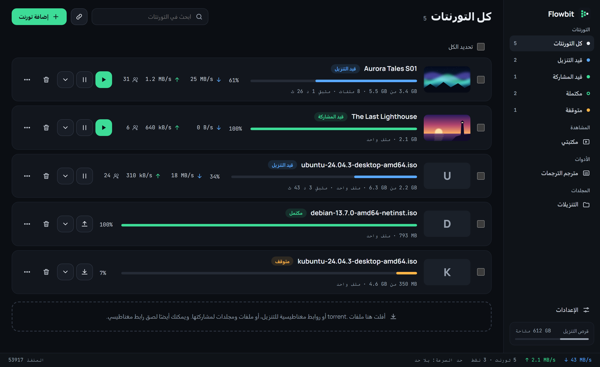
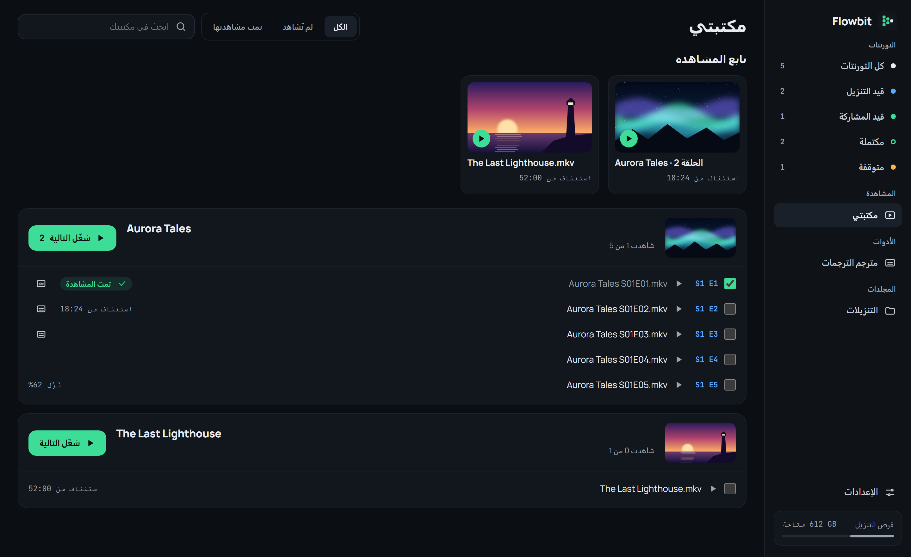
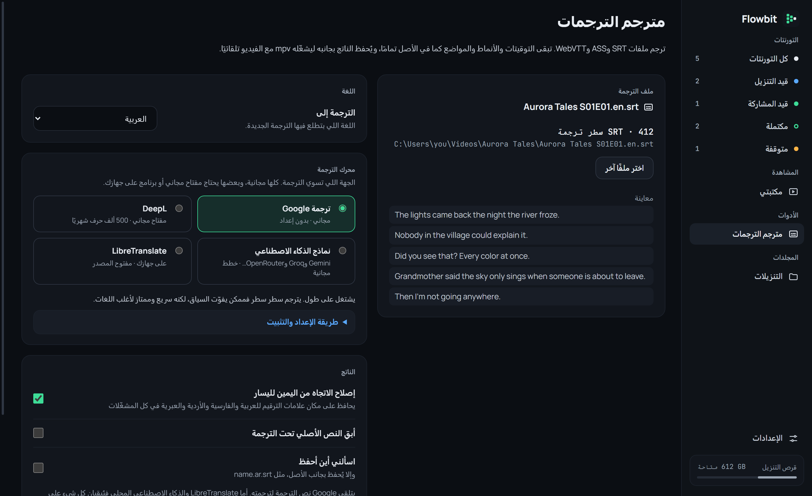

  

<h1 align="center">Flowbit</h1>

  <strong>شاهد التورنت وهو يُنزَّل.</strong> 
  برنامج تورنت مجاني ومفتوح المصدر لويندوز ولينكس، 
  فيه مكتبة للمشاهدة ومترجم للترجمات. 
  بدون إعلانات، وبدون حساب، ومجانًا بالكامل.

  
  &nbsp;
  

  
  
  
  

  <a href="README.md">English</a> · <b>العربية</b>

  

## المزايا

### شاهد أثناء التنزيل

اضغط تشغيل ليفتح الفيديو في [mpv](https://mpv.io) بينما يستمر تنزيل الباقي. واختر الملفات التي تريدها واترك ما لا تحتاجه.

### تابع ما تشاهده

أكمل من حيث توقفت. الحلقات مرتبة حسب المسلسل، وما تنتهي منه يُعلَّم تلقائيًا، والصور مأخوذة من الفيديو نفسه.

  

### ترجم الترجمات

ترجم ملفات SRT و WebVTT و ASS إلى 21 لغة، مع بقاء التوقيت والتنسيق والمواضع كما هي تمامًا. ويُحفظ الملف الجديد بجانب الفيديو ليحمّله mpv.

يعمل Google Translate بدون أي إعداد. ويمكنك أيضًا استخدام DeepL أو LibreTranslate أو نماذج الذكاء الاصطناعي (Gemini و Groq و OpenRouter و OpenAI و Ollama وأي خادم متوافق مع OpenAI)، ولكل منها شرح للإعداد داخل البرنامج. وتراعي الترجمة بالذكاء الاصطناعي سياق الجمل السابقة وتحافظ على الأسماء، ويمكنك اختيار العربية الفصحى أو الخليجية أو المصرية أو الشامية.

  

### ومزايا أخرى

- **واجهة عربية كاملة** من اليمين إلى اليسار، بجانب الإنجليزية، مع مظهر فاتح وداكن
- **حدّد ما تريد أو حدّد الكل** واحذفها معًا، مع ملفاتها أو بدونها
- **شارك** ملفاتك ومجلداتك، أو أنشئ ملف `.torrent`
- **حدود لسرعة التنزيل والرفع**، ومنفذ الاتصال، ومتتبعات إضافية
- **إيقاف تلقائي عند الاكتمال**، أو استمر في مشاركة ما تختاره
- **خفيف في شريط المهام:** حوالي 60 ميجابايت والنافذة مغلقة
- **يفتح روابط magnet وملفات `.torrent`** بدون صلاحيات المسؤول

## التنزيل

نزّل آخر إصدار من **[صفحة الإصدارات](https://github.com/GENERAL868/flowbit/releases/latest)**.

### ويندوز

لويندوز 10 و11 (64 بت)، و mpv مضمَّن معه.

| الملف | الوصف |
|---|---|
| `Flowbit-x.y.z-setup.exe` | مثبّت لحسابك فقط، بدون صلاحيات المسؤول |
| `Flowbit-x.y.z-portable.zip` | نسخة محمولة: فك الضغط في أي مكان وشغّل `Flowbit.exe`، وتبقى الإعدادات في المجلد نفسه |

### لينكس

للتوزيعات 64 بت من عام 2022 فما بعد. وحزم `.deb` و `.rpm` تثبّت mpv تلقائيًا.

| التوزيعة | الملف | التثبيت |
|---|---|---|
| Ubuntu و Debian و Mint و Pop!_OS | `Flowbit-x.y.z-linux-amd64.deb` | `sudo apt install ./Flowbit-x.y.z-linux-amd64.deb` |
| Fedora و openSUSE و RHEL | `Flowbit-x.y.z-linux-x86_64.rpm` | `sudo dnf install ./Flowbit-x.y.z-linux-x86_64.rpm` |
| غيرها | `Flowbit-x.y.z-linux-x86_64.AppImage` | ثبّت `mpv`، ثم `chmod +x Flowbit-*.AppImage` وشغّله |

## معلومات مفيدة

<b>ويندوز يقول إنه حمى جهازي</b>

 
البرنامج غير موقّع رقميًا بعد، لذلك يعرض SmartScreen تحذيرًا. اختر <b>مزيد من المعلومات ← التشغيل على أي حال</b>.

<b>التورنت لا يبدأ التنزيل</b>

 
يتصل Flowbit بالأجهزة الأخرى عبر TCP، ولا تعمل التورنتات التي مصادرها روابط ويب فقط أو متصفحات (WebRTC) فقط.

<b>أين توجد إعداداتي؟</b>

 
في <code dir="ltr">%LOCALAPPDATA%\app.flowbit.desktop</code> على ويندوز، و<code dir="ltr">~/.local/share/app.flowbit.desktop</code> على لينكس. أما النسخة المحمولة فتحفظها في مجلدها.

هذا البرنامج أداة عامة الاستخدام، فالرجاء تنزيل ومشاركة ما يحق لك فقط.

## المساهمة

نرحب بالإبلاغ عن الأخطاء وبالترجمات وطلبات الدمج.

- [دليل المساهمة](CONTRIBUTING.md) و[قواعد السلوك](CODE_OF_CONDUCT.md)
- [البناء من الكود وتنظيم المشروع](docs/DEVELOPMENT.md)
- [سياسة الأمان](SECURITY.md)
- [سجل التغييرات](CHANGELOG.md)

## الرخصة

رخصة البرنامج هي [MIT](LICENSE)، وللمكونات الخارجية رخصها الخاصة: librqbit (Apache-2.0) و mpv (GPL-2.0-or-later) والخطوط (SIL OFL 1.1). التفاصيل في [THIRD_PARTY_NOTICES.md](THIRD_PARTY_NOTICES.md).

