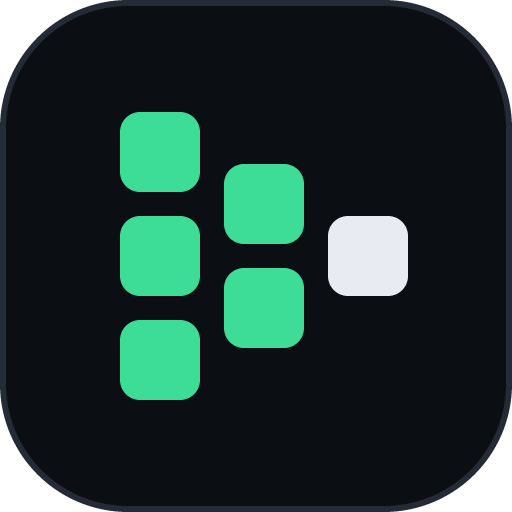
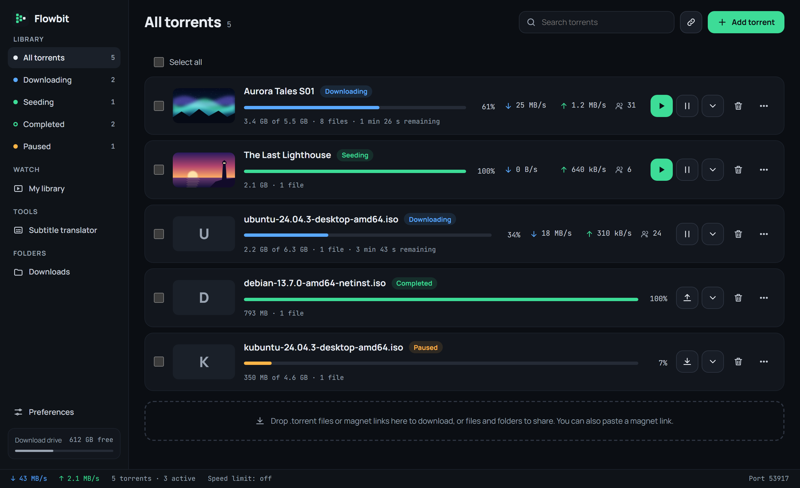
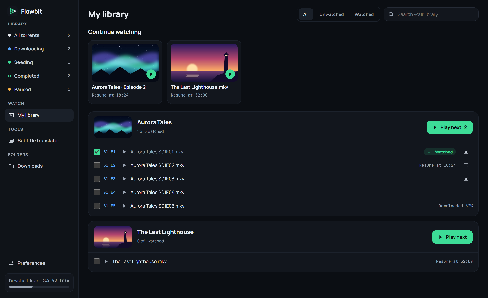
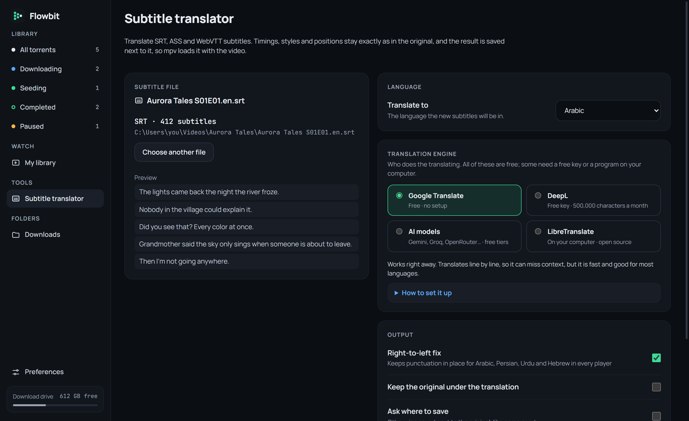

  

<h1 align="center">Flowbit</h1>

  <strong>Watch torrents while they download.</strong> 
  A free, open-source torrent client for Windows and Linux, 
  with a watch library and a subtitle translator built in.

  
  

  
  
  
  

  <b>English</b> · <a href="README.ar.md">العربية</a>

  

No ads, no account, nothing to pay.

## Features

### Stream while it downloads

Press play and the video opens in [mpv](https://mpv.io) while the rest keeps downloading. Choose which files to get, and leave out the ones you don't need.

### Keep track of what you watch

Pick up where you stopped. Episodes are grouped by show, finished ones are marked for you, and posters come from the videos themselves.

  

### Translate subtitles

Translate SRT, WebVTT and ASS files into 21 languages. Timings, styles and positions stay exactly as they were, and the result is saved next to the video so mpv loads it.

Google Translate works with no setup. You can also use DeepL, LibreTranslate or AI models (Gemini, Groq, OpenRouter, OpenAI, Ollama, or any OpenAI-compatible server), with a setup guide for each inside the app. AI translation follows the context of earlier lines, keeps names consistent, and can write Modern Standard, Gulf, Egyptian or Levantine Arabic.

  

### And more

- **English and Arabic**, with a full right-to-left layout, in light and dark themes
- **Select torrents** or all of them, and remove them together, with or without their files
- **Share** your own files and folders, or create a `.torrent`
- **Download and upload limits**, listening port and extra trackers
- **Stop when finished**, or keep seeding the torrents you choose
- **Light in the tray:** about 60 MB with the window closed
- **Opens magnet links and `.torrent` files**, without admin rights

## Download

Get the latest version from the **[Releases page](https://github.com/GENERAL868/flowbit/releases/latest)**.

### Windows

For Windows 10 and 11, 64-bit. mpv is included.

| File | |
|---|---|
| `Flowbit-x.y.z-setup.exe` | Installer, for your account only (no admin rights) |
| `Flowbit-x.y.z-portable.zip` | Portable: unzip anywhere and run `Flowbit.exe`; settings stay in the folder |

### Linux

For 64-bit distributions from 2022 on. The `.deb` and `.rpm` packages install mpv for you.

| Distribution | File | Install |
|---|---|---|
| Ubuntu, Debian, Mint, Pop!_OS… | `Flowbit-x.y.z-linux-amd64.deb` | `sudo apt install ./Flowbit-x.y.z-linux-amd64.deb` |
| Fedora, openSUSE, RHEL… | `Flowbit-x.y.z-linux-x86_64.rpm` | `sudo dnf install ./Flowbit-x.y.z-linux-x86_64.rpm` |
| Any other | `Flowbit-x.y.z-linux-x86_64.AppImage` | Install `mpv`, then `chmod +x Flowbit-*.AppImage` and run it |

## Good to know

<b>Windows says it protected my PC</b>

 
Flowbit isn't code-signed yet, so SmartScreen warns about it. Choose <b>More info → Run anyway</b>.

<b>A torrent won't start downloading</b>

 
Flowbit connects to peers over TCP. Torrents that only have web seeds or only browser (WebRTC) peers won't download.

<b>Where are my settings?</b>

 
In <code>%LOCALAPPDATA%\app.flowbit.desktop</code> on Windows and <code>~/.local/share/app.flowbit.desktop</code> on Linux. The portable version keeps them in its own folder.

Flowbit is a general-purpose tool. Please download and share only what you have the right to.

## Built with

| | |
|---|---|
| **Torrent engine** | [librqbit](https://github.com/ikatson/rqbit), in Rust |
| **App** | [Tauri](https://tauri.app) 2, on the system's webview |
| **Player** | [mpv](https://mpv.io), in its own window with its own controls and shortcuts |
| **Interface** | Plain JavaScript, no build step |

## Contributing

Bug reports, translations and pull requests are welcome.

- [Contributing guide](CONTRIBUTING.md) and [code of conduct](CODE_OF_CONDUCT.md)
- [Building from source and how the code is laid out](docs/DEVELOPMENT.md)
- [Security policy](SECURITY.md): how to report a problem privately, and what's already protected
- [Changelog](CHANGELOG.md)

## License

[MIT](LICENSE). Third-party parts keep their own licenses: librqbit (Apache-2.0), mpv (GPL-2.0-or-later) and the fonts (SIL OFL 1.1). See [THIRD_PARTY_NOTICES.md](THIRD_PARTY_NOTICES.md).
